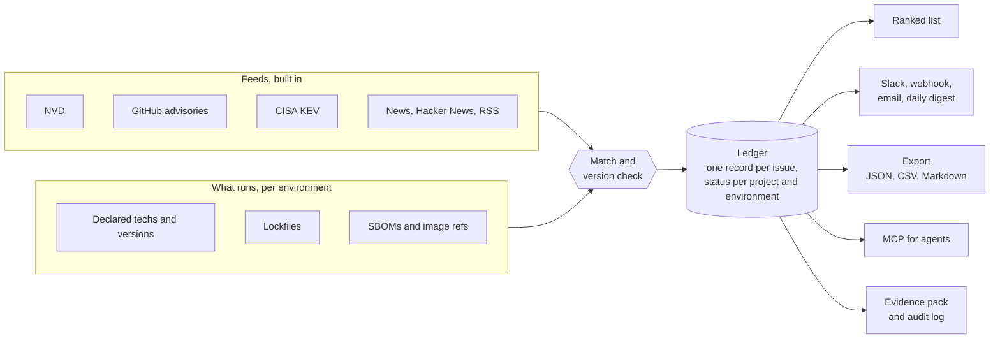
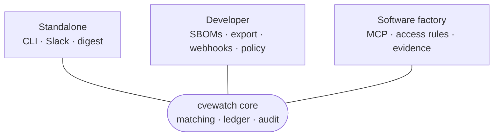
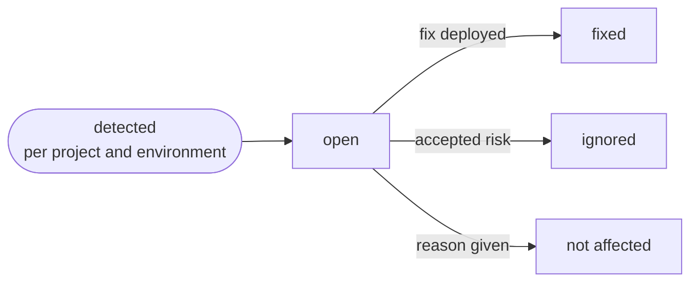
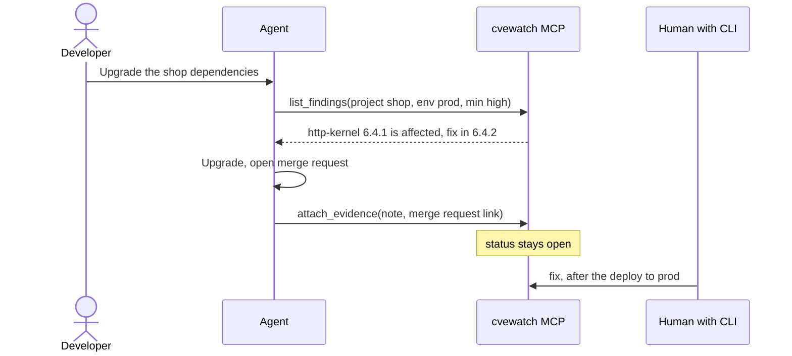

# cvewatch

**Know which of your projects and environments are still exposed to which known vulnerability, who owns the fix, and what has happened so far.**

[](https://github.com/b070nd/cvewatch/actions/workflows/ci.yml)

Security feeds tell you *that* something is vulnerable. Scanners tell you *where* a version is bad at one moment. Neither answers the question a lead actually asks on Monday morning: **"Is it still open in prod, and who is on it?"** cvewatch watches the feeds that matter to your stack, matches them to what every environment really runs, and keeps the open, fixed and ignored status per project and environment, with the evidence, on your own machine.

```text
$ cvewatch update -env prod -min high

Open findings: 3

CRITICAL (2)
  NEW CVE-2026-109618   shop: prod  [affected]  (+1 ids)
      PHP Group PHP: PHP Memory Corruption Vulnerability
      published 6d 9h ago · 2 articles · KEV, CISA due 2026-10-29 · EPSS 100% · official fix: action
  NEW CVE-2026-103515   shop: prod  [affected]
      GitLab has remediated an issue in GitLab EE affecting all versions from 19.2…
      published 6d 22h ago · 1 article · official fix: advisory

HIGH (1)
      CVE-2026-108082   middleware: prod  [unchecked]
      Symfony: ReDoS in HeaderUtils::split() reachable through the Cache-Control request header
      published 3h ago · 0 articles · official fix: 6.4.46
```

*Illustrative output built from real feed data. Tracking is per environment, so the same CVE can be open in prod and fixed in staging.*

## At a glance

| | |
|---|---|
| **Watches** | NVD, GitHub advisories, CISA KEV, Hacker News and any RSS or Atom feed |
| **Tech-agnostic** | a built-in catalog of ~145 open and closed source technologies, and any other in a few lines of YAML |
| **Knows what you run** | declared techs and versions, lockfiles and SBOMs, per project **and environment**; `setup` finds them in your repository, with evidence |
| **Decides** | what matters to you, whether your version is affected, and what to do first |
| **Tracks** | open, fixed, ignored or not-affected per environment, with owner, deadline, ticket and evidence |
| **Tells** | Slack, signed webhook, email, a daily digest, JSON/CSV/Markdown/SARIF exports, a status page, an MCP server |
| **Shows** | a full-screen TUI, a static dashboard and `cvewatch status`: is the monitor itself working? |
| **Proves** | a hash-chained audit log and an evidence pack per issue |
| **Runs as** | one binary, on your machine, no telemetry |

## How it works



The picture people care about is the **exposure matrix**: every project against every environment, so "fixed in staging, still open in prod" is visible at a glance.

```text
 CVE-2026-109618  (critical · KEV · EPSS 100%)

                  dev       int       staging   prod
  shop            fixed     fixed     fixed     OPEN           owner alice · due Oct 31 · SEC-12
  middleware      -         -         -         OPEN           no owner yet
  admin           ignored   -         -         not affected   "feature disabled"

  fixed = deployed   OPEN = still exposed   - = project has no such environment
```

## Any stack, not just the usual suspects

cvewatch is **tech-agnostic**: nothing in it is specific to PHP, Node or any one vendor. What it covers is data you control, in three layers:

| Layer | What you give it | What you get |
|---|---|---|
| **Technologies**: runtimes, frameworks, databases, servers, platforms, appliances | a name and a version in the project file; the name must exist in `techs.yaml` | advisories about that product are matched from NVD, KEV and news, and the version is checked against affected ranges where the feed has them |
| **Packages** | a lockfile or SBOM: composer, npm, Go, pip, poetry, Pipfile, Gradle, Maven, CycloneDX, SPDX | exact per-package matching, with each ecosystem's own version rules |
| **Anything else** | just the technology name | it is matched by name and the finding stays `unchecked` until a person confirms the version |

About 145 technologies ship in the box, open and closed source: runtimes, frameworks, databases, web and app servers, CMS and commerce platforms, CI/CD, container and cloud tooling, network and security appliances, operating systems. `cvewatch catalog fortinet` searches them. Only technologies a project declares are judged, so the size of the list adds no noise, and some carry their vendor's advisory feed, which switches on with them. Something missing? A few lines in `config/techs.yaml` add it (or replace a shipped entry; `disabled: true` removes one), for example Grafana:

```yaml
# config/techs.yaml   (holds only your additions; the shipped catalog is always there)
techs:
  - name: grafana
    aliases: [grafana]
    cpe: [grafana:grafana]      # the product name in the NVD CPE dictionary; optional, but it gives version checks
```

`cvewatch doctor -online` confirms the CPE name exists. A project in a language without a supported lockfile (Rust, Ruby, .NET, Swift...) is still covered at the technology level, and its packages are covered as soon as you export a CycloneDX or SPDX SBOM that uses a supported ecosystem. Package-level matching for more ecosystems is added the same way the existing ones were: one adapter.

## Pick your path

| You are... | You want... | Start here |
|---|---|---|
| **A standalone user** running a few systems | an honest list of what to patch first, delivered where you already look | [Standalone](#1-standalone-user) |
| **A developer or integrator** | to wire it into CI, tickets, SBOMs and your own tools | [Developer / integrator](#2-developer--integrator) |
| **A software factory** with several products and AI agents | one source of truth for exposure that people and agents share safely | [MCP and software factories](#3-mcp-and-software-factories) |



---

## 1. Standalone user

*"I run a webshop, a middleware and an admin tool. I need to know what to patch this week without reading ten feeds."*

### Five minutes to a useful list

```bash
go install github.com/b070nd/cvewatch/app/src/cmd/cvewatch@latest   # or Docker, see compose.yaml

mkdir cvewatch-home && cd cvewatch-home
cvewatch init                          # writes a starter config
cvewatch setup ~/code/shop             # guided: finds technologies, versions and lockfiles, shows the evidence, asks you to confirm
cvewatch doctor                        # checks everything and tells you what to fix
cvewatch update                        # fetch the feeds now, then show what is open
cvewatch tui                           # or browse and triage in a full-screen interface
```

`setup` looks at lockfiles, `.tool-versions`, `go.mod`, `package.json`, Dockerfiles, compose files, Kubernetes manifests and Terraform, also in monorepos, and says why it believes each thing ("nginx 1.25.3: image in `docker-compose.yml`"). Guesses it is unsure about are asked, not declared. `cvewatch init -repo ~/code/shop` does the same without questions.

The list of technologies and feeds is built in, so one binary is enough. `init` writes a project file per repository, and you adjust the versions it could not guess (a repository says what is *declared*, not what *runs in prod*).

### What it does for you

- **Cuts the noise.** An advisory only matches when it is about a product you run, so "a Moodle plugin written in PHP" does not raise your PHP alarm. Versions are checked per environment: *affected*, *not affected* or *unchecked*, using each ecosystem's own rules (PEP 440, Maven, semver).
- **Puts the urgent things first.** Order: actively exploited (CISA KEV), then severity, open in prod, exploit probability (EPSS, optional), age. Every issue says why it ranks where it does.
- **Merges the duplicates.** The NVD entry, the GitHub advisory, the CISA listing and two news stories become one record with all links, the articles in order, and the known fix.
- **Tells you where you already look.** Slack, a signed webhook or email, plus a daily "still open in prod" digest.

```text
  What comes first
  ┌──────────────┐   ┌──────────┐   ┌──────────────┐   ┌────────┐   ┌─────┐
  │ KEV: already │ → │ severity │ → │ open in prod │ → │  EPSS  │ → │ age │
  │ exploited    │   │          │   │              │   │ (opt.) │   │     │
  └──────────────┘   └──────────┘   └──────────────┘   └────────┘   └─────┘
```

### A week with cvewatch

**Monday.** The digest lands in Slack: *"8 open · 0 overdue · critical 2"*. You pick the first one:

```bash
cvewatch show CVE-2026-109618          # description, fix, articles, plan per environment
cvewatch why  CVE-2026-109618          # "php@8.2.10: named in the advisory's product data, in the affected range"
cvewatch assign CVE-2026-109618 -project shop -env prod -owner alice -due 2026-10-31 -ticket https://tickets.example/SEC-12
```

**Wednesday.** The fix goes to staging, then prod:

```bash
cvewatch evidence add CVE-2026-109618 -project shop -env prod -note "php 8.2.30 image deployed" -url https://ci.example/run/77
cvewatch fix CVE-2026-109618 -project shop -env staging -note "8.2.30"
cvewatch fix CVE-2026-109618 -project shop -env prod    -note "8.2.30"
```

**A dev-only finding.** You decide it does not apply and say why, on the record:

```bash
cvewatch not-affected CVE-2026-109619 -project shop -env dev -note "dev has no network exposure"
```

**Friday.** A teammate asks what was done about it. One command answers with a timeline of detection, alerts, status changes, owners and evidence:

```bash
cvewatch evidence CVE-2026-109618
```

**Always on.** Run `cvewatch daemon` (or the Docker image) and it refreshes every few hours. If you upgrade a lockfile, the open findings are re-checked on their own and each finding's history says what changed.

### The life of a finding



Any closed finding can be reopened, and when your inventory changes the open ones are re-checked against the new versions. Every change is recorded: who, when and why, in the finding's history and in the audit log.

---

## 2. Developer / integrator

*"I want vulnerability exposure in our pipelines, our ticket system and our dashboards, without a platform to host."*

### Feed it what you actually ship

Inventory is declared per project and environment, and read fresh every cycle:

```yaml
# config/projects/shop.yaml
name: shop
envs: [dev, prod]
techs: [{name: php, version: "8.3"}]
lockfiles:
  - {type: composer,  path: /repos/shop/composer.lock}
  - {type: cyclonedx, path: /releases/shop-prod.cdx.json, env: prod}   # the SBOM of what is deployed in prod
environments:
  prod: {techs: {php: "8.2.30"}, image: "registry.example/shop@sha256:ab12..."}   # recorded, not scanned
```

Supported inputs: composer, npm, Go (`go.mod`), pip, poetry, Pipfile.lock, Gradle, Maven and CycloneDX / SPDX SBOMs. `cvewatch inventory` shows what it believes runs where and what it could not read.

**Example: releasing.** Your pipeline writes `shop-prod.cdx.json` (from Syft, cdxgen or your build tool) when release 2.4 goes live. On the next cycle cvewatch notices the inventory changed, re-checks the open prod findings against the new versions, flips the ones that are now outside the affected range to *not affected*, and records `php@8.2.10 → php@8.2.30; now not_affected` in each finding's history. Nobody edits a status by hand.

### Get data out in a stable shape

```bash
cvewatch export -format json -env prod > open-prod.json    # versioned, see docs/schema/export-v1.schema.json
cvewatch export -format csv  -min high > open-high.csv     # spreadsheet-safe
cvewatch export -format md             > STATUS.md         # for a wiki or a PR comment
```

JSON from `export`, `list -json` and MCP is **one** document: `schema_version`, `generated_at`, `count`, `issues`. Feed text sits under `untrusted`. Pin your parser to `schema_version`.

### Push to your own tools

Channels switch on when their secret is in the environment, so one config file is safe to share:

```yaml
# config/config.yaml
notify:
  webhook: {url_env: CVEWATCH_WEBHOOK_URL, secret_env: CVEWATCH_WEBHOOK_SECRET, min_severity: high}
  email:   {host: smtp.example.com, from: sec@example.com, to: [leads@example.com], username_env: SMTP_USER, password_env: SMTP_PASS}
  digest:  {daily_at: "08:00", env: prod}
```

Webhook payloads are JSON, signed with HMAC-SHA256 in `X-Cvewatch-Signature`. Verify before you trust them:

```python
import hmac, hashlib
expected = "sha256=" + hmac.new(secret, body, hashlib.sha256).hexdigest()
if not hmac.compare_digest(expected, request.headers["X-Cvewatch-Signature"]):
    abort(401)
```

Point the webhook at a small bridge that opens Jira or GitLab issues, or at a Teams connector. Delivery is tracked per channel, so a failing mailbox never causes duplicate Slack alerts.

### Enforce deadlines

```yaml
policy:
  rules:
    - {name: kev-prod, env: prod, kev: true, owner_within: 24h, fix_within: 168h}
```

```bash
cvewatch policy || notify-oncall "exposure deadlines missed"    # exits non-zero when a rule or a due date is broken
```

### Make it yours

- **Add a feed type:** one parser file in `app/src/feeds`, registered by name.
- **Add a channel:** implement `notify.Channel` (name, send alerts, send digest).
- **Choose storage:** a JSON file by default; `storage: {backend: sqlite}` when several processes share it.
- **Test with confidence:** `src/testkit` runs real cycles over a temporary config, and `src/golden` replays synthetic NVD, GitHub, KEV and news items through the shipped configuration. A wrong CPE name in `techs.yaml` **fails CI**.

Architecture and seams: [docs/architecture.md](docs/architecture.md). Contributing: [CONTRIBUTING.md](CONTRIBUTING.md).

---

## 3. MCP and software factories

*"We build many products. People and AI agents both touch dependencies. We need one source of truth for exposure, and a clear line between what agents may read and what only humans decide."*

### Give your agents the truth, read-only

```bash
claude mcp add cvewatch -- /path/to/cvewatch -root /path/to/cvewatch-home mcp
```

Read-only by default. The agent can call:

| Tool | Answers |
|---|---|
| `list_findings` | what is open, most urgent first, filtered by severity, project, environment |
| `get_vulnerability`, `explain` | details with articles in order and fix evidence; why it matched |
| `get_evidence` | the full timeline and per-environment matrix for one issue |
| `policy_violations` | which deadlines are broken right now |
| `get_calendar` | what was published this month |
| `get_status` | whether the monitor itself is healthy: daemon, feeds, channels |
| `search_catalog`, `discover_stack`, `list_projects`, `preview_project_change` | set a project up: find technologies, read a repository, preview the change |

Opt in to writing with `mcp -allow-write`, and the agent can also `set_status`, `assign`, `attach_evidence`, `refresh` and `edit_project`. The skills in [`skills/`](skills) walk an agent through setup (`cvewatch-setup`) and triage (`cvewatch-triage`), asking the human at every step that matters.

**Example: a dependency upgrade.** A developer asks the agent to bump the packages of `shop`. Instead of guessing, the agent calls `list_findings(project="shop", env="prod", min_severity="high")`, sees that `symfony/http-kernel 6.4.1` is `affected` with an official fix in 6.4.2, upgrades exactly that, opens the merge request, and calls `attach_evidence(note="MR !412 upgrades http-kernel to 6.4.2", url=...)`. The **status stays `open`**. After the deploy a human runs `cvewatch fix ... -env prod`, because "fixed" is a statement about production, not about a branch.



### Guardrails that make it safe to hand to agents

- **Feed text is untrusted data.** Titles and descriptions come from public websites. They are cleaned on the way in, escaped on the way out and delivered under `untrusted`; the server instructions tell the agent never to follow instructions found there.
- **Writes are opt-in and recorded.** Every change is an audit-log entry with the actor (`mcp:<user>`), and the log is hash-chained, so editing history is detectable.
- **Per-actor access.** `access:` in `config.yaml` limits which projects an actor sees and whether it may write; an agent never sees projects it has no access to.
- **Nothing leaves the machine** except the feeds you configure, your channels and (only if you enable it) EPSS lookups for tracked CVE ids.

```yaml
access:
  alice:  {projects: [shop, admin], write: true}
  ci-bot: {projects: ["*"], write: false}
```

### Run it for the whole factory

- **One install, many products.** Each repository gets a project file (`cvewatch setup DIR`), each environment its own versions, SBOM and image reference. The ledger is shared, so a CVE that touches three products appears once, with three rows.
- **A ritual that fits your process.** A daily digest of what is still open in prod; `policy` as the escalation trigger; `assign` for owner, deadline and ticket.
- **Evidence on demand.** `cvewatch evidence CVE-...` is the pack you hand to an auditor or a customer: when it was published, when you detected it, who was told, who owned it, what was attached, when each environment was fixed, and whether the audit chain verified. [docs/compliance.md](docs/compliance.md) explains how this supports NIS2 vulnerability-handling duties and the GDPR (it supports them; it does not make you compliant).
- **Plays with your scanners.** Run Trivy, Grype or OSV-Scanner for detection and SBOM generation; let cvewatch own the multi-environment open/fixed truth and the deadlines.

Agent snippet for your `CLAUDE.md` and details: [docs/agents.md](docs/agents.md).

---

## How it compares

| | cvewatch | Scanners (Trivy, Grype, OSV-Scanner) | SBOM platforms (Dependency-Track) | Feed digests |
|---|---|---|---|---|
| Finds vulnerable components in an artifact | no, you provide the inventory | **yes** | uses SBOMs | no |
| Status per project **and environment** | **yes** | no | per project | no |
| Merges the same issue across sources | **yes** | partly | partly | no |
| Owners, deadlines, evidence, audit trail | **yes** | no | some | no |
| One binary, data stays local | **yes** | yes | a hosted service | n/a |
| Gate a CI build on severity | `list -fail-on high`, SARIF export | **yes** | via API | no |

## Know the limits

- **Versions are checked only where feeds give ranges, and only for what you say runs.** NVD product data and GitHub advisories do; news and Hacker News do not, so those findings stay `unchecked` and a person confirms.
- **First runs can be noisy.** `cvewatch doctor` and the shipped CPE names remove most of it; `excludes`, `match_structured`, `match_title_only` and `-min` tune the rest. Config edits apply to items first seen afterwards; `rescan` looks back on purpose.
- **No distro or OS-package advisories** (Debian, Alpine, Red Hat...) and no offline mode: use a scanner for what is inside an image, and cvewatch for who is exposed and what happened next.
- **Package-level matching covers ten input formats today** (composer, npm, Go, pip, poetry, Pipfile, Gradle, Maven, CycloneDX, SPDX). Other stacks are covered by technology name, not by package.
- **Fixes are what feeds say.** No package or container registry is queried and nothing is scanned. Image references are recorded, not verified.
- **Authorization relies on the local identity.** It is for people you can identify otherwise, not a public service.
- **Windows:** owner-only file modes are not enforced by the OS; keep `data/` in the user profile. Linux, macOS and Windows are tested in CI.

## Security and privacy

Outbound requests go only to the feeds and channels you configure, plus FIRST's EPSS service if you turn it on. No telemetry. State and reports are created owner-only, secrets live in the environment and never in logs, and all feed text is treated as untrusted. Details and a threat model: [docs/security.md](docs/security.md). Report vulnerabilities privately as described in [SECURITY.md](SECURITY.md).

## Documentation

- [docs/overview.md](docs/overview.md): how it works, inventory, matching, tracking, policy, channels, storage
- [docs/architecture.md](docs/architecture.md): modules and seams
- [docs/agents.md](docs/agents.md): MCP tools, JSON contract, a `CLAUDE.md` snippet
- [docs/compliance.md](docs/compliance.md): NIS2 and GDPR support, evidence an auditor can ask for
- [docs/schema/export-v1.schema.json](docs/schema/export-v1.schema.json): the data contract
- [CONTRIBUTING.md](CONTRIBUTING.md), [CHANGELOG.md](CHANGELOG.md)

## License

[MIT](LICENSE) © 2026 Botond Biro
